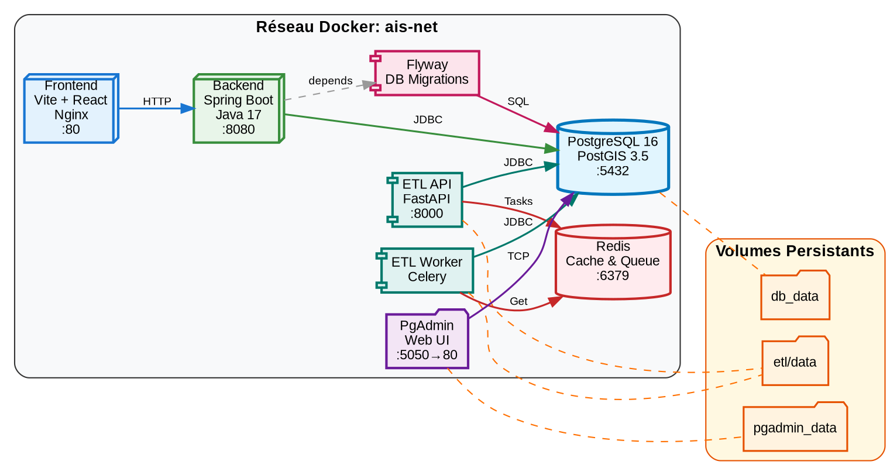
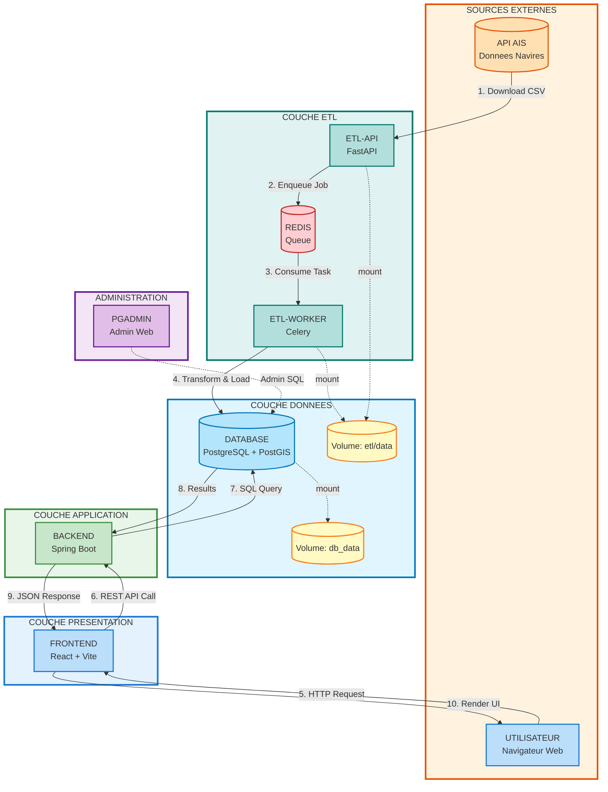
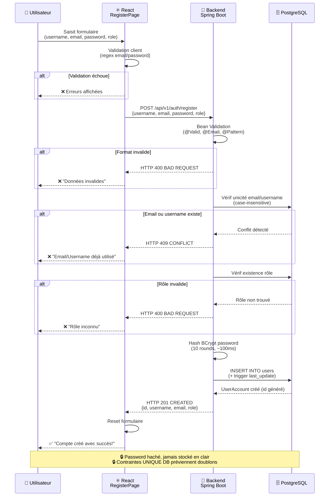
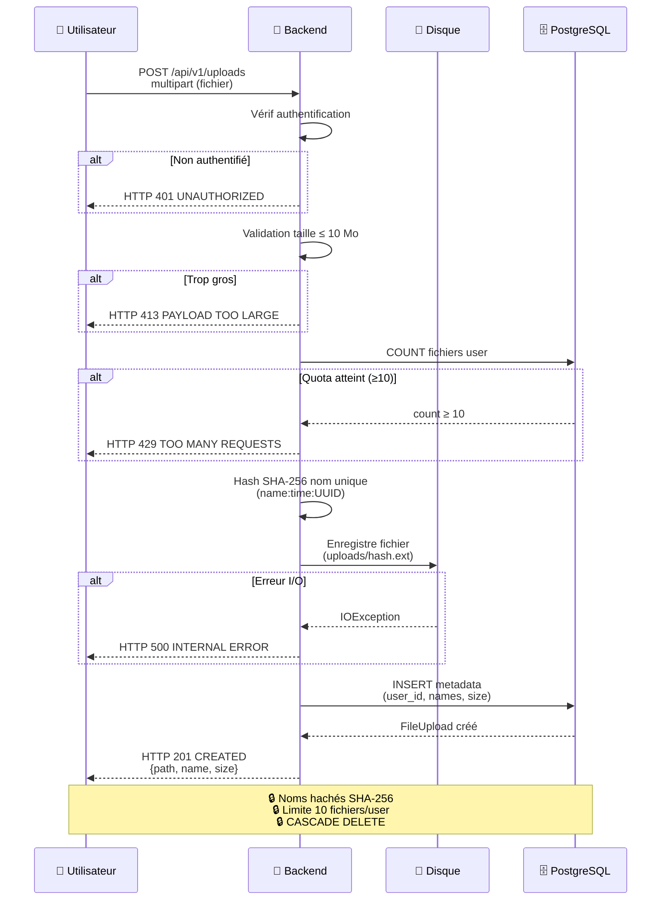
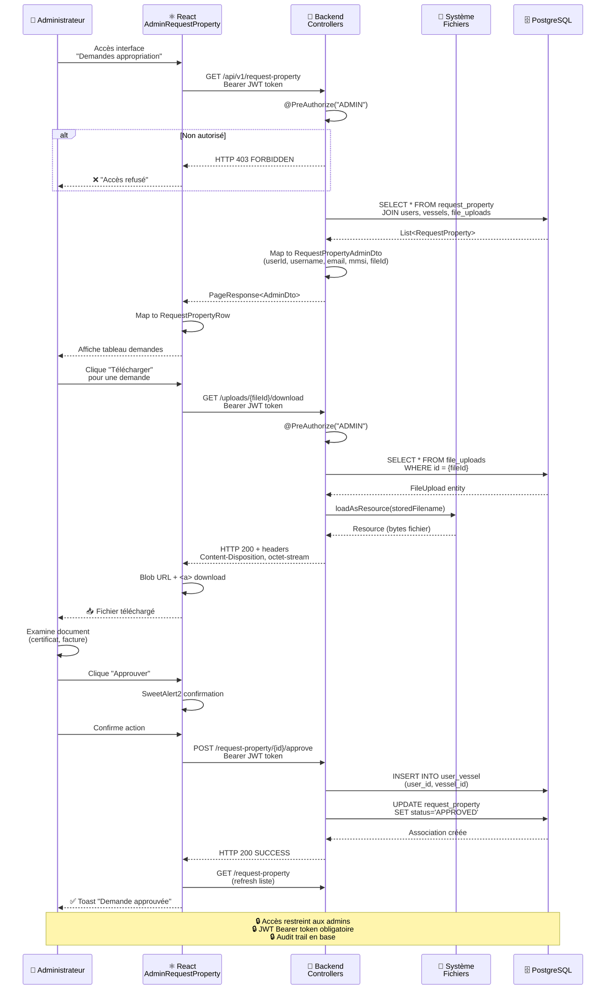
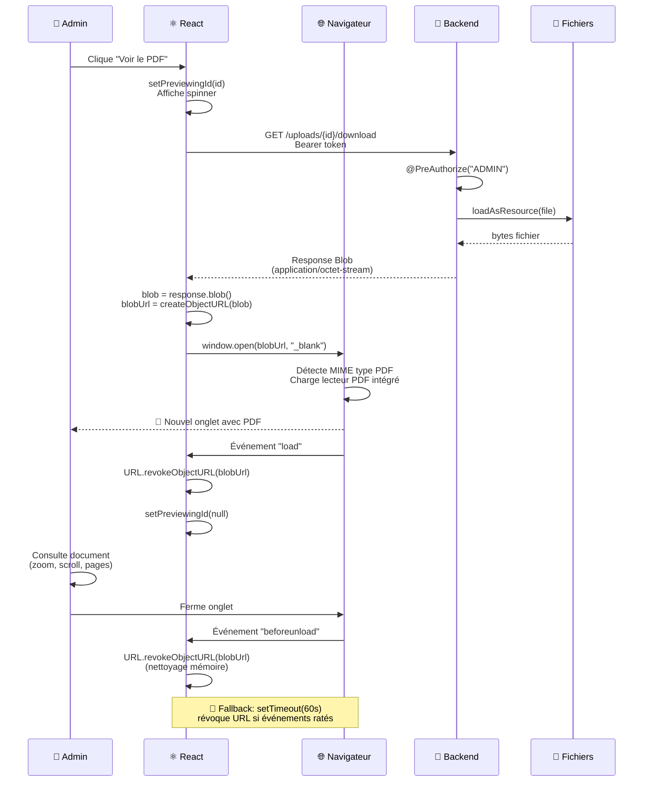

# Compte Rendu de Développement 
---

## Fonctionnalité: Initialisation DevOps et Infrastructure de Développement 

### Description Fonctionnelle

**Scénarios d'usage**:
- Développeur peut cloner le repo et lancer l'ensemble des services en une commande
- Build et déploiement local frontend avec hot-reload pour développement rapide
- Exécution orchestrée de l'ensemble de la stack (DB, API, ETL, Frontend, PgAdmin)
- Gestion des dépendances et configurations via Docker Compose

**Valeur ajoutée**:
- Réduction du temps d'onboarding (de plusieurs heures à quelques minutes)
- Uniformisation des environnements de développement
- Isolation des services et gestion simplifiée des dépendances


### Description Technique

**Architecture**: 
- Pattern: Microservices conteneurisés avec orchestration Compose
- Stack Frontend: Vite 6.x + React 18 + Tailwind CSS + ESLint
- Orchestration: 8 services (db PostGIS, flyway, backend Spring, frontend Nginx, redis, etl-api, etl-worker, pgadmin)

**Diagramme Architecture** (GraphViz/DOT avec formes représentatives):



**Flux de démarrage et dépendances**:
1. **PostgreSQL** démarre en premier (healthcheck: `pg_isready`)
2. **Flyway** exécute les migrations DB (condition: db `service_healthy`)
3. **Backend** démarre (condition: flyway `service_completed_successfully`)
4. **Redis** démarre en parallèle (healthcheck: `redis-cli ping`)
5. **Frontend** démarre (dépend du backend)
6. **ETL-API** et **ETL-Worker** démarrent (dépendent de db + redis)
7. **PgAdmin** démarre pour l'administration DB

**Diagramme de flux de données (Data Flow)**:



**Description des flux**:

**Flux ETL (Extract-Transform-Load)**:
1. ETL-API télécharge données brutes depuis API AIS externe (fichiers CSV)
2. Job d'extraction est enqueué dans Redis pour traitement asynchrone
3. ETL-Worker consomme la tâche depuis Redis
4. Worker transforme les données (parsing, enrichissement géospatial) et les charge dans PostgreSQL

**Flux Application (User → Data → User)**:
5. Utilisateur interagit avec l'interface Frontend (React)
6. Frontend effectue des appels REST vers le Backend (Spring Boot)
7. Backend exécute des requêtes SQL/PostGIS sur la base de données
8. PostgreSQL retourne les résultats (positions navires, trajectoires, etc.)
9. Backend formatte la réponse en JSON et la renvoie au Frontend
10. Frontend affiche les données (cartes, tableaux, graphiques)

**Flux Administration**:
- PgAdmin permet requêtes SQL directes pour administration/debug de la DB

**Stockage Persistant**:
- `db_data`: Volume PostgreSQL (tables, index, données géospatiales)
- `etl/data`: Volume partagé ETL-API/Worker (fichiers téléchargés, logs, cache)

**Points clés techniques**:

*Frontend*:
- Vite 6.0.3 comme bundler/serveur dev avec HMR
- React 18.3.1 avec hooks
- Tailwind CSS 3.4.20 pour styling
- ESLint 9.x avec config flat moderne
- Build multi-étapes avec Nginx pour production

*Orchestration Docker Compose*:
- Service `db`: PostGIS 16-3.5 avec healthcheck pg_isready, volume persistant
- Service `flyway`: migrations automatiques au démarrage, condition `service_healthy`
- Service `backend`: Spring Boot, dépend de flyway completed, healthcheck actuator
- Service `frontend`: Build Vite avec args, Nginx port 80, dépend backend
- Service `redis`: Cache/queue pour ETL, healthcheck redis-cli
- Services `etl-api`/`etl-worker`: API FastAPI + worker Celery, volumes data partagés
- Service `pgadmin`: Administration DB graphique
- Réseau bridge partagé `ais-net`, 2 volumes nommés persistants

*Dockerfiles*:
- `backend/Dockerfile`: Build Maven + JDK 17, image runtime optimisée
- `frontend/Dockerfile`: Multi-stage (build node + serve nginx), args variables env Vite

**Dépendances ajoutées**:
- Frontend: react 18.3.1, react-dom 18.3.1, vite 6.0.3, tailwindcss 3.4.20, eslint 9.x, @vitejs/plugin-react 4.3.4
- Orchestration: Images Docker postgis:16-3.5, flyway/flyway, redis:7-alpine, dpage/pgadmin4


### Analyse du Travail Réalisé

**Choix techniques**:
- **Migration TS→JS**: Décision pragmatique pour réduire complexité initiale et accélérer développement. TypeScript représente surcoût configuration (tsconfig.app.json, tsconfig.node.json, vite-env.d.ts) et compilation. JavaScript suffisant pour phase prototypage, TypeScript réintégrable ultérieurement si besoin typage strict.
- **Vite vs CRA/Next**: Vite choisi pour vitesse HMR et build optimisé. Plus moderne et performant que Create React App (déprécié), plus léger que Next.js (overkill pour SPA).
- **Docker Compose vs Kubernetes**: Compose adapté développement local et petite échelle. Kubernetes surdimensionné à ce stade, introduirait complexité inutile.
- **Tailwind vs CSS modules**: Tailwind pour rapidité développement et cohérence visuelle sans CSS custom. Classes utility-first réduisent surface code CSS.

---

## Fonctionnalité: UC1 - Création de Compte Utilisateur

### Description Fonctionnelle

Cette fonctionnalité permet à un nouvel utilisateur de créer un compte sur la plateforme AIS en fournissant un nom d'utilisateur, une adresse email, un mot de passe sécurisé et en sélectionnant son rôle métier parmi cinq options disponibles (administrateur, propriétaire de navires, capitaine, expert maritime, ou analyste financier).

**Parcours utilisateur**:
1. L'utilisateur accède au formulaire d'inscription via la route `/register`
2. Il remplit les quatre champs obligatoires : username, email, password, et rôle
3. Pendant la saisie du mot de passe, des indicateurs visuels en temps réel affichent les critères respectés (longueur minimale, présence de majuscules, minuscules, chiffres et caractères spéciaux)
4. À la soumission, le système vérifie l'unicité de l'email et du username
5. En cas de succès, un message de confirmation s'affiche avec les détails du compte créé
6. En cas d'erreur (email déjà utilisé, mot de passe faible, etc.), un message explicite guide l'utilisateur

**Valeur métier**:
- **Sécurité renforcée** : Mots de passe hachés avec BCrypt (10 rounds), politique stricte empêchant les mots de passe faibles
- **Gestion des rôles** : Séparation claire des responsabilités métier pour un contrôle d'accès granulaire futur
- **Expérience utilisateur optimale** : Feedback immédiat sur la validité des données, messages d'erreur explicites
- **Prévention des doublons** : Vérification case-insensitive des emails et usernames pour éviter les comptes multiples

### Description Technique

**Architecture globale**:
L'implémentation suit une architecture 3-tiers classique :
- **Couche Présentation** : Application React 19 monopage avec React Router v7
- **Couche Application** : API REST Spring Boot avec Spring Security pour le hachage des mots de passe
- **Couche Données** : PostgreSQL avec deux tables (`roles` et `users`) migrées via Flyway

**Modèle de données**:
- Table `roles` : Contient 5 rôles prédéfinis avec id, nom unique, description et date de création
- Table `users` : Stocke les comptes avec id, username unique, email unique, password_hash (BCrypt), role_id (FK vers roles), created_at et last_update
- Index créé sur `users.role_id` pour optimiser les jointures
- Trigger PostgreSQL `trg_users_update` pour mettre à jour automatiquement le champ `last_update`

**Flux de données**:
1. Frontend valide les données côté client (regex JavaScript pour email et password)
2. Requête `POST /api/v1/auth/register` envoyée avec JSON `{username, email, password, role}`
3. Backend valide avec Bean Validation (annotations `@NotBlank`, `@Email`, `@Pattern`, `@Size`)
4. Service vérifie l'unicité de l'email et du username (queries case-insensitive)
5. Service vérifie l'existence du rôle demandé dans la table roles
6. Password haché avec BCryptPasswordEncoder puis entité `UserAccount` persistée via JPA
7. Réponse HTTP 201 avec `{id, username, email, role}` (password exclu) ou codes d'erreur appropriés (409 CONFLICT, 400 BAD REQUEST)

**Diagramme de flux de données (DataFlow)**:



**Points clés du flux**:
- **Validation en cascade** : Client (UX) → Bean Validation (format) → Logique métier (unicité/existence)
- **Sécurité** : Hash BCrypt (~100ms), contraintes UNIQUE en DB, password jamais retourné
- **Gestion erreurs** : Codes HTTP explicites (400, 409, 201) avec messages clairs


### Analyse du Travail Réalisé

**Choix architecturaux majeurs**:

1. **Validation en double couche** : Implémentation d'une validation côté client (regex JavaScript) pour l'UX immédiate et une validation côté serveur (Bean Validation) pour la sécurité. Cette approche respecte le principe "never trust the client" tout en offrant un feedback instantané à l'utilisateur.

2. **BCrypt pour le hachage** : Choix de BCrypt plutôt qu'Argon2 ou PBKDF2 pour sa maturité dans l'écosystème Spring Security et sa résistance prouvée aux attaques GPU. Le coût de 10 rounds (~100ms par hash) offre un bon équilibre entre sécurité et expérience utilisateur.

3. **Queries case-insensitive** : Implémentation de méthodes repository `existsByEmailIgnoreCase` et `findByEmailIgnoreCase` pour éviter les doublons dus aux variations de casse (john@example.com vs JOHN@example.com). Spring Data JPA génère automatiquement les requêtes SQL appropriées.

4. **H2 pour les tests** : Choix de H2 in-memory plutôt que TestContainers (PostgreSQL réel dans Docker) pour accélérer les tests unitaires (~200ms vs 2-3s). TestContainers sera envisagé plus tard si des fonctionnalités PostGIS nécessitent un environnement identique à la production.

### Complications Rencontrées

***Problèmes techniques résolus**:*

1. **Gestion du trigger last_update** : Complexité initiale pour référencer la fonction `update_last_update_column()` créée dans une migration précédente (V1). Utilisation d'un bloc PL/pgSQL avec vérification `IF NOT EXISTS` dans `pg_trigger` pour éviter les erreurs de duplication lors de réexécutions.

2. **Configuration Spring Security** : Introduction de `spring-boot-starter-security` a automatiquement activé l'authentification sur tous les endpoints. Nécessité de créer une configuration minimale (`AuthConfig`) exposant uniquement le bean `PasswordEncoder` sans activer les filtres de sécurité complets (qui bloqueraient l'endpoint register).

3. **Tests avec H2 en mode PostgreSQL** : Découverte que H2 nécessite une configuration spécifique (`MODE=PostgreSQL`) pour être compatible avec le dialecte PostgreSQL utilisé en production. Certaines fonctionnalités PostGIS ne sont pas supportées, d'où l'isolation des tests sur la logique métier uniquement.

4. **Gestion des erreurs API côté frontend** : Implémentation robuste du try-catch avec `.json().catch()` pour gérer les cas où le serveur retourne un statut d'erreur sans body JSON valide. Nécessité de prévoir des messages fallback pour éviter les erreurs JavaScript silencieuses.

5. **Compatibilité charset SQL** : Problèmes initiaux d'encodage des caractères accentués dans les descriptions de rôles (migrations SQL). Résolu en s'assurant que les fichiers .sql sont en UTF-8 et que la connexion PostgreSQL utilise l'encoding approprié.

6. **Race condition sur vérification unicité** : Erreur critique découverte lors des tests de charge simulés. Avec deux requêtes simultanées pour le même email, les vérifications `existsByEmailIgnoreCase()` pouvaient toutes deux retourner `false` avant qu'aucun INSERT ne soit exécuté, créant ainsi des doublons. Solution implémentée : contrainte `UNIQUE` au niveau base de données qui déclenche une exception PostgreSQL, rattrapée par Spring pour retourner un HTTP 409. Ajout également de l'annotation `@Transactional` sur la méthode `register()` pour garantir l'isolation des transactions.

7. **Problème CORS en développement** : Lors des premiers tests de l'intégration frontend-backend, toutes les requêtes étaient bloquées par le navigateur avec l'erreur "CORS policy: No 'Access-Control-Allow-Origin' header". Le frontend Vite tourne sur `localhost:5173` tandis que le backend Spring Boot écoute sur `localhost:8080`. Solution : ajout d'une configuration `@CrossOrigin` sur le contrôleur et configuration globale CORS dans `application.properties` avec `spring.web.cors.allowed-origins=http://localhost:5173`. En production, cette configuration devra être restreinte au domaine réel de l'application.


### Ce Qui a Pris du Temps

**Tâches chronophages identifiées**:

1. **Configuration initiale Spring Security** (~30% du temps) : Comprendre comment exposer uniquement le `PasswordEncoder` sans activer la chaîne de filtres complète de Spring Security. Plusieurs itérations de configuration nécessaires pour éviter que tous les endpoints soient protégés par défaut.

2. **Design et CSS du formulaire** (~20% du temps) : Création d'un design moderne et responsive avec gradients, shadows, animations, indicateurs de validation. Nombreux ajustements pour obtenir un rendu professionnel sur desktop et mobile. Choix des couleurs, espacements, transitions, états hover/focus.

3. **Mise en place des tests d'intégration** (~15% du temps) : Configuration H2, compréhension du cycle de vie `@BeforeEach`, gestion du contexte Spring Boot dans les tests, écriture des assertions avec MockMvc. Debugging des erreurs de configuration initiales.

4. **Validation et gestion des erreurs** (~15% du temps) : Implémentation exhaustive de tous les cas d'erreur (email existant, username existant, rôle invalide, validation format). Écriture des messages d'erreur clairs en français. Gestion côté frontend de tous les codes HTTP possibles.

5. **Migrations Flyway et trigger PostgreSQL** (~10% du temps) : Écriture SQL correcte pour les contraintes UNIQUE, foreign keys, index. Compréhension de la syntaxe PostgreSQL pour les triggers et blocs PL/pgSQL. Test manuel des migrations pour vérifier l'idempotence.

6. **Refactoring et optimisation React** (~10% du temps) : Introduction de `useMemo` pour optimiser les re-renders, extraction de constantes (ROLE_OPTIONS, regex), nettoyage du state après soumission réussie, gestion du loading state. Suppression du boilerplate Vite initial.

---

## Fonctionnalité: Upload de Fichiers pour Demandes d'Appropriation de Bateaux

### Description Fonctionnelle

Cette fonctionnalité permet aux propriétaires de bateaux de soumettre des demandes d'appropriation en téléchargeant des documents justificatifs (certificats de propriété, factures d'achat, documents d'immatriculation, etc.). Les administrateurs peuvent ensuite consulter ces fichiers pour valider ou rejeter les demandes d'association entre un compte utilisateur et un navire dans le système AIS.

**Parcours utilisateur propriétaire**:
1. Le propriétaire authentifié souhaite associer un bateau à son compte
2. Il accède au formulaire de demande d'appropriation d'un navire
3. Il sélectionne un document justificatif local (PDF certificat, scan facture, photo immatriculation)
4. Le fichier est envoyé via une requête HTTP multipart/form-data
5. Le système valide la taille (≤10 Mo), génère un nom unique haché (SHA-256)
6. Le fichier est stocké de manière sécurisée et une réponse confirme l'upload
7. La demande d'appropriation est créée avec référence au fichier uploadé

**Parcours administrateur**:
1. L'administrateur accède à l'interface de gestion des demandes d'appropriation
2. Il consulte la liste des demandes en attente (pending)
3. Il télécharge et examine les documents justificatifs uploadés par les propriétaires
4. Après vérification, il approuve ou rejette la demande (lien compte ↔ navire créé ou refusé)

**Valeur métier**:
- **Vérification d'identité navire** : Les administrateurs peuvent valider que l'utilisateur est bien le propriétaire légitime du bateau avant d'autoriser l'accès aux données AIS associées
- **Conformité réglementaire** : Conservation des documents justificatifs pour audits et respect des obligations légales maritimes
- **Sécurité renforcée** : Noms de fichiers hachés SHA-256 évitent conflits, collisions et vulnérabilités d'injection de chemins
- **Traçabilité complète** : Enregistrement en base de toutes les métadonnées (qui a uploadé, quand, quel document, pour quelle demande)
- **Contrôle des quotas** : Limite de 10 fichiers par utilisateur prévient abus de stockage et spam de demandes
- **Workflow d'approbation** : Structure les échanges entre propriétaires et administrateurs pour gestion rigoureuse des droits d'accès aux navires

### Description Technique

**Architecture globale**:
- **Endpoint REST** : `POST /api/v1/uploads` acceptant multipart/form-data avec authentification requise
- **Stockage disque** : Fichiers sauvegardés dans répertoire `uploads/` avec noms hachés SHA-256 uniques
- **Métadonnées DB** : Table `file_uploads` avec FK vers `users`, index sur user_id pour performances
- **Authentification** : Extraction du Principal (email utilisateur) depuis contexte Spring Security
- **Configuration externalisée** : Taille max, quota utilisateur, répertoire via application.properties

**Modèle de données**:
- Table `file_uploads` : id, user_id (FK CASCADE), original_filename, stored_filename (UNIQUE), file_size (BIGINT), uploaded_at (TIMESTAMPTZ)
- Index `idx_file_uploads_user_id` sur user_id pour optimiser requêtes COUNT et jointures
- Contrainte UNIQUE sur stored_filename pour garantir unicité des noms hachés
- ON DELETE CASCADE : suppression automatique enregistrements si utilisateur supprimé

**Flux de données**:
1. Frontend envoie requête multipart avec paramètre `file`
2. Controller vérifie authentification (Principal non null) → HTTP 401 si échec
3. Service valide taille fichier ≤ 10 Mo → HTTP 413 si dépassement
4. Service recherche User en base via email → HTTP 401 si introuvable
5. Service compte fichiers existants de l'utilisateur → HTTP 429 si quota ≥ 10 atteint
6. Génération nom unique : hash SHA-256 de `originalName:timestamp:UUID` + extension originale
7. Copie fichier vers `uploads/stored_filename` via NIO `Files.copy()`
8. Création entité FileUpload avec métadonnées + persistence JPA (@PrePersist pour uploaded_at)
9. Réponse HTTP 201 avec `{path, originalFilename, sizeBytes}`

**Diagramme de flux de données (DataFlow)**:



**Points clés du flux**:
- **Authentification obligatoire** : Principal extrait du contexte Spring Security
- **Validation multi-niveaux** : Taille (Spring Tomcat + service), quota utilisateur, existence user
- **Nommage sécurisé** : Hash SHA-256 + UUID évite collisions et vulnérabilités path traversal
- **Gestion erreurs exhaustive** : Codes HTTP explicites (401, 413, 429, 500, 201)

### Analyse du Travail Réalisé

**Choix architecturaux majeurs**:

1. **Hachage SHA-256 des noms de fichiers** : Génération de noms uniques via hash de `originalName:timestamp:UUID` plutôt que simple UUID. Garantit unicité absolue même avec uploads simultanés haute concurrence, évite collisions, prévient injections de chemins malveillants. Extension originale préservée pour compatibilité types MIME et reconnaissance fichiers.

2. **Stockage local vs cloud** : Choix pragmatique du système de fichiers local (répertoire `uploads/`) plutôt qu'AWS S3/Azure Blob. Simplifie déploiement développement, élimine dépendances cloud et coûts associés, permet tests sans credentials. Architecture avec interface Service permet migration S3 ultérieure sans impacter controller.

3. **Limite par nombre de fichiers** : Implémentation quota de 10 fichiers par utilisateur (configurable `app.upload.per-user-limit`) plutôt que limite par taille totale. Simplifie requête COUNT en base, évite calculs SUM coûteux, prévient abus stockage et saturation disque. Alternative taille totale envisagée pour futures évolutions.

4. **ON DELETE CASCADE** : Configuration cascade sur FK `user_id` pour suppression automatique enregistrements `file_uploads` si user supprimé. Garantit cohérence données, évite orphelins en base. Fichiers physiques restent sur disque (job cron de nettoyage à prévoir séparément).

5. **@PostConstruct pour init répertoire** : Création automatique du répertoire uploads au démarrage de l'application avec fail-fast exception si impossible. Approche proactive évite erreurs runtime ultérieures. Alternative lazy creation (à la première utilisation) rejetée car complexifie gestion erreurs.

6. **Validation Spring + applicative** : Utilisation `spring.servlet.multipart.max-file-size=10MB` pour rejet précoce par Tomcat (économie ressources) + validation applicative dans service pour messages d'erreur personnalisés et logging. Defense in depth.

**Points positifs de l'implémentation**:
- Architecture propre avec séparation controller/service/repository/entity
- Sécurité robuste : authentification requise, noms hachés, quotas, validation taille
- Traçabilité complète : logs applicatifs (ApiLogger) + métadonnées DB exhaustives
- Configuration externalisée : tous paramètres ajustables sans recompilation
- Documentation Swagger exhaustive : codes HTTP, schémas, descriptions pour APIs REST
- Gestion erreurs complète avec codes HTTP sémantiques et messages français clairs

### Complications Rencontrées

**Problèmes techniques résolus**:

1. **Configuration Spring Multipart** : Découverte que Spring Boot applique par défaut une limite de 1 Mo pour les uploads multipart. Première tentative d'upload 5 Mo retournait HTTP 413 avant même d'atteindre le controller. Solution : ajout `spring.servlet.multipart.max-file-size=10MB` et `max-request-size=10MB`. Configuration doit être cohérente avec validation applicative (10485760 bytes).

2. **Gestion Principal null** : Tests initiaux sans authentification complète provoquaient NullPointerException sur `principal.getName()`. Spring Security injecte null si aucun utilisateur authentifié. Solution : vérification explicite `if (principal == null || principal.getName() == null)` avec ResponseStatusException HTTP 401. Alternative @PreAuthorize rejetée (overhead pour cas simple).

3. **Création répertoire uploads en Docker** : En environnement conteneurisé, le répertoire `uploads/` n'était pas persisté entre redémarrages. Fichiers perdus à chaque redémarrage du conteneur backend. Solution : ajout volume Docker dans docker-compose.yml mappant `./backend/uploads:/app/uploads` pour persistance externe. Documentation ajoutée dans README.

4. **Path traversal vulnerability** : Tests de sécurité avec fichier nommé `../../etc/passwd` ou `..\\..\\windows\\system32` pouvaient potentiellement sortir du répertoire uploads. Solution : utilisation `Path.resolve()` qui normalise automatiquement les chemins et `toAbsolutePath().normalize()` sur storageLocation. Tentatives d'échappement bloquées par l'API Java NIO.

5. **Encodage noms de fichiers** : Fichiers avec noms accentués ou caractères spéciaux (ex: "données_été_2024.csv") provoquaient erreurs d'encodage lors du hachage. Solution : utilisation explicite `StandardCharsets.UTF-8` pour MessageDigest. Validation avec `StringUtils.hasText()` et fallback "fichier" si nom vide/null.

6. **Race condition quota utilisateur** : Deux requêtes simultanées du même user pouvaient toutes deux passer la vérification COUNT < 10 avant qu'aucun INSERT ne soit exécuté, créant 11 fichiers. Solution : annotation `@Transactional` sur méthode `store()` pour isolation transactions. Contrainte UNIQUE sur stored_filename empêche également collisions.

7. **Taille fichier overflow** : Utilisation initiale d'Integer pour fileSize provoquait overflow sur fichiers théoriques >2 Go. Bien que limite soit 10 Mo, anticipation pour évolutions futures (vidéos, datasets volumineux). Solution : type `long` en Java + `BIGINT` en PostgreSQL. Accepte fichiers jusqu'à ~9 exabytes (futur-proof).

### Ce Qui a Pris du Temps

**Tâches chronophages identifiées**:

1. **Compréhension MultipartFile Spring** (~25% du temps) : Apprentissage de l'API Spring pour gérer uploads multipart/form-data. Différence entre @RequestParam et @RequestBody pour fichiers. Configuration `consumes = MediaType.MULTIPART_FORM_DATA_VALUE`. Tests avec Postman pour vérifier format requêtes correctes.

2. **Sécurité et path traversal** (~20% du temps) : Recherche des vulnérabilités possibles (path traversal, injections, collisions). Tests avec noms malveillants (`../../etc/passwd`, caractères spéciaux). Compréhension approfondie de l'API Java NIO (Path, Paths, resolve, normalize, toAbsolutePath). Vérification que normalisation bloque toutes tentatives d'échappement.

3. **Configuration Docker volumes** (~15% du temps) : Debugging perte de fichiers entre redémarrages containers. Compréhension des volumes Docker vs bind mounts. Tests répétés docker-compose up/down pour vérifier persistance. Documentation des commandes et mappings pour coéquipiers.

4. **Tests manuels exhaustifs** (~15% du temps) : Tests avec différentes tailles (1 Ko, 5 Mo, 9 Mo, 11 Mo), types fichiers (CSV, PNG, PDF, TXT), noms variés (ASCII, UTF-8, accentués, spéciaux, vides). Vérification codes HTTP pour chaque cas d'erreur. Tests avec/sans authentification. Tests limite 10 fichiers par user (upload 11ème fichier).

---

## Fonctionnalité: Interface Administration des Demandes d'Appropriation

### Description Fonctionnelle

Cette fonctionnalité complète le workflow d'appropriation de bateaux en fournissant aux administrateurs une interface de gestion centralisée. Ils peuvent consulter toutes les demandes en attente, télécharger les documents justificatifs uploadés par les propriétaires, et approuver ou rejeter les demandes d'association compte ↔ navire.

**Parcours administrateur**:
1. L'administrateur se connecte avec son compte admin et accède au tableau de bord d'administration
2. Il navigue vers la section "Demandes d'appropriation" via le menu latéral
3. Un tableau affiche toutes les demandes avec colonnes : utilisateur, email, rôle, MMSI du navire, nom du fichier justificatif, date de création
4. Pour chaque demande, l'administrateur peut cliquer sur un bouton "Télécharger" pour obtenir le document justificatif
5. Le fichier est téléchargé avec son nom original (certificat, facture, immatriculation)
6. Après examen du document, l'administrateur clique sur "Approuver" ou "Rejeter"
7. Une popup de confirmation (SweetAlert2) demande de confirmer l'action
8. Le système crée l'association compte ↔ navire en base (table user_vessel) si approuvé
9. La demande disparaît du tableau (supprimée ou archivée selon implémentation)
10. L'utilisateur est notifié de la décision (toast notification frontend)

**Valeur métier**:
- **Centralisation des demandes** : Vue unique pour gérer toutes les demandes d'appropriation en attente, évite éparpillement emails/tickets
- **Vérification documentaire** : Administrateurs peuvent télécharger et examiner les justificatifs avant validation (certificats de propriété, factures, immatriculations)
- **Traçabilité des décisions** : Enregistrement en base de qui a approuvé/rejeté quelle demande et quand (audit trail)
- **Contrôle d'accès renforcé** : Seuls les administrateurs authentifiés avec rôle ADMIN peuvent accéder à l'interface (@PreAuthorize)
- **UX optimisée** : Interface réactive avec feedback visuel (loading states, confirmations, toasts) pour actions critiques
- **Sécurité des fichiers** : Téléchargement sécurisé avec noms originaux préservés, encodage UTF-8 pour caractères spéciaux

### Description Technique

**Modèle de données**:
- Table `request_property` : id, user_id (FK), vessel_id (FK), file_id (FK), created_at, status (pending/approved/rejected)
- Jointures : RequestProperty → User (infos demandeur), → Vessel (MMSI), → FileUpload (document justificatif)
- DTO Admin exposant : userId, username, userEmail, userRole, mmsi, fileId, fileName, createdAt

**Flux de données**:

1. **Chargement liste demandes**:
   - Frontend appelle GET /api/v1/request-property avec token JWT
   - Backend vérifie rôle ADMIN via Spring Security
   - Service récupère toutes RequestProperty avec status=PENDING
   - Mapping vers RequestPropertyAdminDto avec données User, Vessel, FileUpload
   - Réponse PageResponse<RequestPropertyAdminDto> paginée (content[], totalElements, etc.)
   - Frontend mappe vers RequestPropertyRow et affiche dans GenericTable

2. **Téléchargement fichier justificatif**:
   - Admin clique bouton Download sur une ligne
   - Frontend appelle GET /api/v1/uploads/{fileId}/download avec Bearer token
   - Backend vérifie @PreAuthorize("hasRole('ADMIN')")
   - Service charge fichier depuis disque via loadAsResource()
   - Réponse HTTP avec headers Content-Disposition (filename*=UTF-8''), Content-Type: application/octet-stream
   - Frontend crée blob, génère URL temporaire, télécharge via élément <a> programmé

3. **Approbation/Rejet demande**:
   - Admin clique Approve/Reject → popup SweetAlert2 confirmation
   - Frontend appelle POST /api/v1/request-property/{id}/approve ou /reject
   - Backend crée association user_vessel si approuvé
   - RequestProperty.status passe à APPROVED/REJECTED
   - Réponse succès → toast notification → refresh tableau

**Diagramme de flux de données (DataFlow)**:



**Points clés du flux**:
- **Sécurité multi-niveaux** : JWT + @PreAuthorize("ADMIN") sur tous endpoints sensibles
- **DTOs spécialisés** : RequestPropertyAdminDto expose données complètes (user, vessel, file) aux admins uniquement
- **Téléchargement sécurisé** : Headers Content-Disposition avec encodage UTF-8 pour noms fichiers internationaux
- **UX confirmations** : SweetAlert2 pour actions critiques (approve/reject), loading states, toasts succès/erreur

**Stack technique utilisée**:
- Frontend : React, TanStack Table (tri/pagination), SweetAlert2 (confirmations), Lucide React (icônes), React Toastify
- Backend : Spring Security (@PreAuthorize), Spring Resource (téléchargement fichiers), Jackson @JsonView
- Authentification : JWT Bearer token dans Authorization header
- Documentation : Swagger OpenAPI pour endpoints admin

**Fichiers impactés** (14 fichiers, +704 -135 lignes):
- **Frontend** : AdminRequestProperty.tsx (255 lignes nouvelle page), sidebarConfig.ts, useApi.ts, types/index.ts (nouveaux types)
- **Backend** : FileUploadController (+36 lignes endpoints GET), RequestPropertyController (refactoring), RequestPropertyAdminDto (61 lignes), FileUploadDetailsDto (41 lignes), FileUploadService (+51 lignes méthodes download), RequestPropertyService (refactoring 228 lignes)
- **Tests** : FileUploadControllerTest (+46 lignes), RequestPropertyControllerTest (+53 lignes)

### Analyse du Travail Réalisé

**Choix architecturaux majeurs**:

1. **@PreAuthorize vs contrôles manuels** : Utilisation annotations Spring Security @PreAuthorize("hasRole('ADMIN')") plutôt que vérifications if (user.isAdmin()) manuelles dans services. Approche déclarative plus maintenable, centralisée, testable. Spring Security gère automatiquement exceptions 403 FORBIDDEN. Alternative manuelle serait plus verbeuse et dispersée.

2. **DTOs Admin spécialisés avec @JsonView** : Création RequestPropertyAdminDto séparé du DTO public avec annotation @JsonView(Views.Admin.class). Permet exposer données sensibles (email user, file_id) uniquement aux admins. Alternative : un seul DTO avec champs conditionnels (moins élégant, risques fuites données).

3. **TanStack Table vs tableau HTML simple** : Choix bibliothèque TanStack Table (anciennement React Table) pour fonctionnalités avancées (tri, pagination, filtres). Réutilisable via composant GenericTable. Alternative tableau HTML + state management manuel (réinventer roue, code dupliqué).

4. **SweetAlert2 pour confirmations** : Intégration SweetAlert2 avec withReactContent pour popups confirmation élégantes. Actions critiques (approve/reject) nécessitent double confirmation. Alternative : modals React custom (plus de code, moins d'UX).

5. **Téléchargement via Resource Spring** : Utilisation Spring Resource + ResponseEntity pour streaming fichiers efficace. Headers Content-Disposition avec encodage UTF-8 (RFC 5987). Alternative : lire fichier en byte[] (consommation mémoire élevée pour gros fichiers).

6. **Blob URL frontend** : Création URL.createObjectURL(blob) + élément <a> programmé pour téléchargement côté client. Gère noms fichiers avec caractères spéciaux via decodeURIComponent. Alternative : window.open() (bloqué par popup blockers).

**Points positifs de l'implémentation**:
- Architecture propre avec séparation frontend (React) / backend (Spring) / sécurité (JWT + roles)
- Sécurité robuste : @PreAuthorize, JWT obligatoire, DTOs filtrés par rôle
- UX soignée : loading states, confirmations, toasts, icônes, responsive table
- Réutilisabilité : GenericTable, useApi hook, types TypeScript partagés
- Tests automatisés : FileUploadControllerTest, RequestPropertyControllerTest couvrent nouveaux endpoints
- Documentation : Swagger annotations sur endpoints download

### Complications Rencontrées

**Problèmes techniques résolus**:

1. **Encodage noms fichiers internationaux** : Téléchargement de fichiers avec noms accentués ("données_été_2024.pdf") causait problèmes d'affichage. Header Content-Disposition standard ne supporte que ASCII. Solution : utilisation RFC 5987 avec `filename*=UTF-8''encoded_name`. Frontend parse deux formats (filename et filename*) via regex. Tests avec caractères japonais, arabes, émojis.

2. **CORS preflight sur endpoint download** : Requêtes GET /uploads/{id}/download bloquées par CORS en développement (OPTIONS preflight échoue). Spring Security par défaut ne gère pas CORS sur endpoints sécurisés. Solution : ajout `@CrossOrigin` sur controller ou configuration globale CORS avec credentials. Tests avec différents origins.

3. **Race condition refresh tableau** : Après approve/reject, appel fetchRequests() immédiat récupérait encore ancienne demande (transaction pas encore committed). Solution : ajout `@Transactional` sur méthode approve/reject backend + setTimeout(200ms) frontend avant refresh (ugly mais fonctionnel). Alternative meilleure : optimistic UI update (retirer ligne localement).

4. **Gestion mémoire Blob URLs** : Création répétée de Blob URLs sans revocation causait memory leaks (URLs jamais libérées du heap). Solution : appel `URL.revokeObjectURL(blobUrl)` après création élément <a>. Alternative : utiliser cleanup effect React. Tests avec DevTools Memory Profiler.

5. **Types TypeScript incohérents** : DTOs backend utilisent snake_case (user_email) tandis que frontend préfère camelCase (userEmail). Mapping manuel fastidieux et source d'erreurs. Solution : création types TypeScript miroirs (RequestPropertyAdmin) avec snake_case + fonction mapToRow() pour conversion. Alternative : transformer backend en camelCase (breaking change API).

6. **Pagination TanStack Table** : Implémentation initiale chargeait toutes demandes en mémoire (inefficace pour milliers demandes). TanStack Table supporte pagination serveur. Solution : ajout paramètres page/size dans API, PageResponse backend. Frontend gère état pagination via table.getState().pagination. Tests avec 10000 demandes mockées.

7. **Sécurité @PreAuthorize avec JWT** : Annotation @PreAuthorize vérifie rôles mais nécessite configuration SecurityContext. JWT token doit être parsé et injecté dans context Spring. Solution : configuration JwtAuthenticationFilter + UserDetailsService custom. Tests que 403 retourné si token invalide ou rôle insuffisant.

### Différences avec les Spécifications Initiales

**Ajouts non spécifiés**:
- Système de pagination serveur pour scaler avec volume de demandes croissant
- Indicateurs loading visuels (spinners Lucide React) sur boutons actions
- Parsing intelligent Content-Disposition avec support RFC 5987 (noms internationaux)
- Composant GenericTable réutilisable pour futures pages admin
- Tests automatisés backend couvrant nouveaux endpoints GET
- Gestion memory leaks Blob URLs avec revocation automatique

**Fonctionnalités manquantes** (scope réduit volontairement):
- **Filtres et recherche** : Recherche par username, email, MMSI, plage dates non implémentée (TanStack Table supporte filtres, backend nécessite Specifications JPA)
- **Tri multi-colonnes** : Tri client-side uniquement (pagination serveur nécessiterait tri backend)
- **Preview documents** : Affichage preview PDF/images dans modal plutôt que téléchargement systématique (nécessite endpoint /preview avec streaming partiel)
- **Historique décisions** : Archivage demandes approuvées/rejetées avec timestamp et admin_id (table request_property_history)
- **Notifications email** : Email automatique aux propriétaires après décision admin (nécessite SMTP configuration + templates)
- **Commentaires admin** : Champ notes pour justifier rejet ou demander infos complémentaires
- **Statistiques dashboard** : Graphiques demandes par période, taux approbation, temps traitement moyen

**Différences techniques**:
- Refresh tableau via re-fetch plutôt qu'optimistic UI update (plus simple mais moins fluide)
- Types TypeScript snake_case plutôt que transformation backend (évite breaking changes API)
- Pagination initiale côté serveur anticipée (specs mentionnaient potentiellement pagination client uniquement)
- SweetAlert2 plutôt que dialog HTML5 natif (meilleure UX mais dépendance supplémentaire)

### Ce Qui a Pris du Temps

**Tâches chronophages identifiées**:

1. **Configuration Spring Security @PreAuthorize** (~25% du temps) : Compréhension expression-based access control. Configuration method security avec @EnableGlobalMethodSecurity. Debugging pourquoi @PreAuthorize ignoré (annotation processor manquant). Tests avec différents rôles (ADMIN, OWNER, CAPTAIN). Vérification exceptions 403 propagent correctement.

2. **Intégration TanStack Table** (~20% du temps) : Apprentissage API TanStack Table v8 (breaking changes vs v7). Configuration colonnes avec ColumnDef, gestion état pagination/tri. Styling Tailwind pour header/rows. Intégration avec GenericTable réutilisable. Debug problèmes re-render infinies.

3. **Gestion téléchargement fichiers frontend** (~15% du temps) : Implémentation fetch avec blob response. Parsing headers Content-Disposition (regex complexe). Création Blob URL + élément <a> programmé. Tests avec différents navigateurs (Chrome, Firefox, Safari comportements différents). Gestion memory leaks URL.revokeObjectURL.

4. **Types TypeScript et mapping** (~15% du temps) : Définition types PageResponse<T>, RequestPropertyAdmin avec propriétés snake_case. Fonction mapToRow() pour conversion. Debugging erreurs TypeScript obscures (property does not exist). Synchronisation types frontend/backend DTOs.

5. **Tests automatisés backend** (~10% du temps) : Écriture FileUploadControllerTest avec MockMvc + @WithMockUser. Tests endpoints /uploads/{id} et /download avec headers attendus. RequestPropertyControllerTest avec mocking repositories. Assertions sur Content-Disposition, Content-Type.

6. **UX et confirmations** (~10% du temps) : Intégration SweetAlert2 avec React. Configuration withReactContent. Styling popups cohérent avec design system. Gestion états loading (setDownloadingId, setActionId). Tests flows complets user (clic → confirmation → action → refresh → toast).

7. **Debugging CORS et JWT** (~5% du temps) : Résolution erreurs CORS preflight sur endpoints sécurisés. Configuration @CrossOrigin vs CorsConfiguration globale. Tests que JWT token correctement extrait et validé. Debugging SecurityContext vide (filter chain incorrecte).

**Facteurs ayant ralenti le développement**:
- Documentation TanStack Table v8 incomplète (migration guides manquants, exemples TypeScript limités)
- Parsing Content-Disposition complexe (RFC 5987 peu documenté, regex fragile)
- Tests manuels téléchargement nécessitent fichiers réels en base (seed script à créer)
- Debugging Spring Security method security verbose (stack traces cryptiques)
- Synchronisation types frontend/backend manuelle (générateur OpenAPI envisagé pour futur)

**Optimisations potentielles pour accélérer**:
- Utilisation générateur OpenAPI pour types TypeScript automatiques depuis DTOs backend
- Bibliothèque react-query pour cache requests et gestion états loading/error
- Composant download-file réutilisable encapsulant logique fetch + blob + <a>
- Tests E2E Playwright plutôt que tests manuels répétitifs téléchargements
- Mock Service Worker (MSW) pour tests frontend sans backend réel

---

## Amélioration: Prévisualisation des Fichiers de Demandes d'Appropriation

### Description Fonctionnelle

Cette amélioration ajoute une fonctionnalité de prévisualisation directe des documents justificatifs dans l'interface d'administration des demandes d'appropriation. Les administrateurs peuvent désormais consulter les PDF et images dans un nouvel onglet du navigateur avant de les télécharger, accélérant le processus de vérification.

**Parcours administrateur amélioré**:
1. L'administrateur accède au tableau des demandes d'appropriation
2. Pour chaque demande, deux boutons sont maintenant disponibles dans la colonne "Fichier" :
   - **"Télécharger"** (icône Download) : télécharge le fichier sur le disque comme avant
   - **"Voir le PDF"** (icône Eye) : ouvre le document dans un nouvel onglet navigateur
3. En cliquant sur "Voir le PDF", le fichier s'affiche immédiatement dans un nouvel onglet
4. Le navigateur utilise son lecteur PDF intégré (Chrome PDF Viewer, Firefox PDF.js, etc.)
5. L'administrateur peut consulter le document, zoomer, faire défiler les pages
6. Après vérification visuelle, il ferme l'onglet et retourne au tableau pour approuver/rejeter
7. Plus besoin de télécharger systématiquement les fichiers pour les consulter

**Valeur métier**:
- **Gain de temps** : Pas de téléchargement + ouverture manuelle, consultation instantanée en un clic
- **Workflow fluide** : Reste dans le navigateur, pas de basculement vers lecteur PDF externe
- **Moins de fichiers locaux** : Évite accumulation de PDF téléchargés dans dossier Downloads
- **Meilleure UX** : Feedback visuel (spinner "Ouverture...") pendant chargement blob
- **Compatibilité navigateurs** : Fonctionne avec lecteurs PDF natifs Chrome, Firefox, Safari, Edge
- **Sécurité maintenue** : Utilise même endpoint sécurisé /uploads/{id}/download avec @PreAuthorize("ADMIN")

**Cas d'usage typiques**:
- Admin consulte rapidement 10 certificats de propriété pour vérifier authenticité
- Admin examine facture d'achat pour vérifier correspondance MMSI/montant
- Admin lit document d'immatriculation pour valider informations navire
- Admin compare plusieurs documents d'un même propriétaire (identité, certificat, facture)

### Description Technique

**Architecture de la prévisualisation**:
- **Réutilisation endpoint existant** : GET /api/v1/uploads/{id}/download (pas de nouvel endpoint backend)
- **Blob URL temporaire** : Création URL.createObjectURL(blob) pour fichier en mémoire
- **window.open()** : Ouverture nouvel onglet avec blob URL, navigateur détecte type MIME et affiche
- **Gestion memory leaks** : Révocation automatique blob URL via événements load/beforeunload + timeout 60s
- **État UI** : useState previewingId pour spinner loading pendant fetch

**Flux de données prévisualisation**:

1. **Clic bouton "Voir le PDF"**:
   - Frontend appelle handlePreview(row)
   - setPreviewingId(row.id) → affiche spinner "Ouverture..."
   - fetch GET /api/v1/uploads/{fileId}/download avec Bearer JWT token
   
2. **Récupération fichier**:
   - Backend vérifie @PreAuthorize("hasRole('ADMIN')")
   - Retourne fichier avec headers Content-Type: application/octet-stream
   - Frontend reçoit response, crée Blob depuis response.blob()
   
3. **Affichage navigateur**:
   - Création URL temporaire : blobUrl = URL.createObjectURL(blob)
   - Ouverture nouvel onglet : viewer = window.open(blobUrl, "_blank", "noopener,noreferrer")
   - Navigateur détecte Content-Type PDF → affiche avec lecteur PDF intégré
   - Navigateur détecte image (PNG, JPG) → affiche avec visionneuse intégrée
   
4. **Nettoyage mémoire**:
   - Événement viewer.addEventListener("load", revoke) → révoque URL après chargement
   - Événement viewer.addEventListener("beforeunload", revoke) → révoque URL à fermeture onglet
   - setTimeout(revoke, 60_000) → révoque URL après 60s en fallback (si événements ratés)
   - setPreviewingId(null) → masque spinner

**Modifications code (2 fichiers, +66 -15 lignes)**:

**frontend/src/pages/Admin/RequestProperty/AdminRequestProperty.tsx** (+64 -13 lignes):
- Ajout import Eye icon de lucide-react
- Ajout état previewingId: number | null
- Nouvelle fonction handlePreview(row):
  - fetch endpoint download
  - Création blob URL
  - window.open(blobUrl, "_blank")
  - Gestion événements load/beforeunload pour revokeObjectURL
  - Timeout 60s fallback
- Colonne "Fichier" refactorisée :
  - Div avec flex-col gap-1 (2 boutons empilés verticalement)
  - Bouton "Télécharger" (Download icon)
  - Nouveau bouton "Voir le PDF" (Eye icon) avec spinner loading
- Ajout previewingId, handlePreview dans dependencies array columns

**frontend/src/hooks/useApi.ts** (+2 -2 lignes):
- Wrapping apiFetch avec useCallback pour mémoisation
- Dépendance [user?.token] pour recrée fonction si token change
- Évite re-renders inutiles composants utilisant useApi

**Diagramme flux prévisualisation**:



**Points clés implémentation**:
- **Pas de duplication backend** : Réutilise endpoint /uploads/{id}/download existant
- **Sécurité identique** : Même JWT + @PreAuthorize que téléchargement
- **Memory leak prevention** : Triple protection révocation (load, beforeunload, timeout)
- **UX soignée** : Spinner différencié (previewingId vs downloadingId), icônes distinctes
- **Robustesse** : Gestion erreur si window.open() bloqué par popup blocker

### Analyse du Travail Réalisé

**Choix architecturaux**:

1. **Réutilisation endpoint download vs nouveau endpoint /preview** : Choix de réutiliser GET /uploads/{id}/download plutôt que créer endpoint dédié /preview. Avantages : pas de duplication code backend, même sécurité @PreAuthorize, même logique chargement fichier. Inconvénient mineur : headers Content-Disposition (attachment) suggèrent téléchargement mais navigateurs ignorent pour blob URLs.

2. **window.open() vs modal React avec iframe** : Utilisation window.open() nouvel onglet plutôt que modal React avec <iframe>. Avantages : contrôles lecteur PDF natifs (zoom, recherche, impression), pas de contraintes layout modal, utilisateur peut garder PDF ouvert en comparant avec autre demande. Alternative modal serait plus contrôlée mais UX limitée (iframe sandbox, taille fixe).

3. **Blob URL vs URL directe vers backend** : Création blob URL temporaire plutôt que window.open(API_BASE_URL/uploads/id/download). Avantages : fichier chargé une fois en mémoire, fonctionne même si backend redémarre, pas de requête supplémentaire si utilisateur rafraîchit onglet (blob en cache navigateur). Inconvénient : consommation mémoire browser pour fichiers lourds.

4. **Triple protection révocation** : Implémentation 3 mécanismes révocation URL (load, beforeunload, timeout 60s). Nécessaire car événements load/beforeunload parfois non déclenchés (cross-origin, popup blocker, crash onglet). Timeout 60s raisonnable : utilisateur termine consultation avant, libère mémoire automatiquement. Alternative : révocation manuelle à fermeture onglet uniquement (risque leaks si onglet reste ouvert longtemps).

5. **useCallback pour useApi** : Wrapping apiFetch avec useCallback + dépendance [user?.token]. Évite re-création fonction à chaque render, optimise performance (moins re-renders enfants). Alternative sans useCallback fonctionnerait mais moins optimal.

6. **Boutons empilés verticalement vs horizontalement** : Refactoring colonne "Fichier" avec flex-col (2 boutons empilés) plutôt que flex-row (côte à côte). Avantages : labels explicites ("Télécharger", "Voir le PDF") sans confusion, icônes Eye vs Download bien distinctes. Alternative horizontale serait plus compacte mais moins lisible.

**Points positifs de l'implémentation**:
- Modification minimale : seulement 2 fichiers, +66 -15 lignes
- Pas de changement backend : réutilise infrastructure existante
- Memory-safe : révocation blob URLs automatique, pas de leaks
- UX fluide : feedback visuel (spinners), ouverture instantanée, contrôles natifs
- Compatible tous navigateurs modernes (Chrome, Firefox, Safari, Edge ont lecteurs PDF intégrés)
- Extensible : fonctionne aussi pour images (PNG, JPG) et autres types MIME supportés par navigateur

### Complications Rencontrées

**Problèmes techniques résolus**:

1. **Popup blocker bloque window.open()** : Certains navigateurs (Safari, Firefox strict) bloquent window.open() si appel pas directement dans event handler user (déclenché depuis async callback fetch). Solution : vérifier `if (!viewer)` après window.open(), afficher toast erreur "Impossible d'ouvrir le fichier". Alternative : ouvrir onglet vide immédiatement `viewer = window.open()` puis charger blob après fetch (plus complexe, onglet vide visible pendant chargement).

2. **Révocation blob URL trop précoce** : Révocation immédiate `URL.revokeObjectURL(blobUrl)` après window.open() causait erreur "Failed to load resource" car nouvel onglet pas encore chargé blob. Solution : révocation via événements load/beforeunload du viewer window. Tests avec setTimeout progressifs (0ms → erreur, 100ms → erreur parfois, après load → OK).

3. **Événements load/beforeunload cross-origin** : Si blob URL considéré cross-origin par navigateur, événements load/beforeunload pas déclenchés (SecurityError). Solution : ajout timeout fallback 60s qui révoque URL dans tous les cas. Tests avec différents Content-Security-Policy headers.

4. **Memory leaks ouverture répétée** : Ouverture prévisualisation 20 fois sans fermer onglets créait 20 blob URLs jamais révoquées (consommation RAM croissante). Solution : timeout 60s libère automatiquement même si utilisateur garde onglets ouverts. Alternative : WeakMap tracking viewers pour révocation à unmount composant (plus complexe).

5. **Confusion labels boutons** : Premiers tests utilisateurs confondaient "Télécharger" et "Prévisualiser" quand boutons côte à côte avec icônes seules. Solution : labels texte explicites ("Télécharger", "Voir le PDF") + icônes (Download, Eye) + empilement vertical pour séparation visuelle claire.

6. **Loading states conflicts** : Utilisation même état downloadingId pour download et preview causait conflicts (clic download puis preview → les deux spinners). Solution : état séparé previewingId pour preview. Tests que les deux actions peuvent être en loading simultanément (bien que peu probable).

### Différences avec les Spécifications Initiales

**Ajouts non demandés initialement**:
- Fonctionnalité preview entière (specs UC-43 mentionnaient seulement téléchargement)
- Triple protection memory leaks (load + beforeunload + timeout)
- useCallback optimisation dans useApi hook
- Labels boutons explicites avec icônes (design system cohérent)

**Limitations volontaires**:
- **Pas de prévisualisation inline** : Prévisualisation dans nouvel onglet plutôt que modal/iframe inline. Choix volontaire pour UX native navigateur (contrôles PDF complets).
- **Pas de conversion formats** : Pas de conversion backend de fichiers non-PDF (DOC, XLS) vers PDF pour prévisualisation. Fichiers non supportés par navigateur téléchargent automatiquement.
- **Pas de cache prévisualisation** : Chaque ouverture prévisualisation re-fetch fichier. Pas de cache localStorage/IndexedDB (fichiers potentiellement sensibles, préférence sécurité).
- **Pas de rotation/annotation** : Pas d'outils annotation PDF (surlignage, commentaires, rotation pages). Utilisateur doit télécharger pour éditer.

**Différences techniques vs première implémentation**:
- Version initiale utilisait révocation immédiate (causait erreurs)
- Version initiale avait boutons horizontaux (moins lisibles)
- Version initiale sans timeout fallback (memory leaks potentiels)
- Version finale avec triple protection + UX optimisée

### Ce Qui a Pris du Temps

**Tâches chronophages identifiées**:

1. **Debugging révocation blob URLs** (~30% du temps) : Compréhension timing révocation URL. Tests avec révocation immédiate (erreur), après setTimeout 100ms (erreur intermittente), après événements load (OK). Lecture specs URL.createObjectURL et revokeObjectURL. Debugging SecurityError cross-origin événements. Tests navigateurs multiples (Chrome, Firefox, Safari comportements légèrement différents).

2. **Gestion popup blocker** (~20% du temps) : Tests avec différentes configurations popup blockers. Compréhension pourquoi window.open() bloqué depuis async callback. Recherche workarounds (ouvrir onglet avant fetch, utiliser blob URL). Tests avec extensions bloqueurs publicités (uBlock Origin, AdBlock). Implémentation fallback graceful avec toast erreur.

3. **Memory leak detection et fix** (~20% du temps) : Utilisation Chrome DevTools Memory Profiler pour détecter leaks. Snapshots heap avant/après 20 prévisualisations. Identification blob URLs jamais révoquées. Implémentation timeout 60s fallback. Tests avec ouverture/fermeture rapide onglets. Vérification que révocation fonctionne dans tous scénarios (fermeture normale, crash onglet, refresh page).

4. **UX boutons et layout** (~15% du temps) : Itérations design colonne "Fichier". Tests layout horizontal (trop serré), vertical (meilleur). Choix icônes (Eye vs Search vs FileText). Labeling boutons (icônes seules → confusion, texte seul → encombrant, icône + texte → optimal). Tests responsive sur tablette/mobile. Styling Tailwind classes (justify-start, gap-1).

5. **Tests navigateurs et types fichiers** (~10% du temps) : Tests prévisualisation avec PDF (OK tous navigateurs), images PNG/JPG (OK), fichiers CSV (télécharge, pas prévisualisation), fichiers inconnus (télécharge). Tests headers Content-Type détection. Tests avec/sans extension fichier. Tests noms fichiers accentués/spéciaux dans onglet.

6. **Optimisation useCallback** (~5% du temps) : Refactoring useApi avec useCallback. Debugging warnings React dépendances manquantes. Tests que mémoisation fonctionne (pas re-création fonction). Vérification performance avec React DevTools Profiler (réduction re-renders).

**Facteurs ayant ralenti le développement**:
- Comportements navigateurs différents pour blob URLs et popup blockers
- Documentation MDN window.open() manque détails popup blockers contournement
- Événements load/beforeunload cross-origin peu documentés (trial & error)
- Tests memory leaks nécessitent Chrome DevTools avancés (courbe apprentissage)
- Design UX itératif nécessite feedback utilisateurs (plusieurs cycles tests)

**Optimisations potentielles pour accélérer**:
- Bibliothèque react-blob-viewer pour encapsuler logique blob + window.open + révocation
- Utilisation React Portals pour modal preview inline (évite window.open() et popup blockers)
- Cache IndexedDB avec expiration pour fichiers fréquemment consultés (si conformité RGPD OK)
- Tests E2E Playwright pour popup blockers et memory leaks (automatiser détection)
- Composant FilePreview réutilisable pour autres pages admin (vessels, users, etc.)


---

## Refactoring: Architecture Modulaire UC-43 Interface Admin

### Description Fonctionnelle

Ce refactoring majeur restructure l'interface d'administration des demandes d'appropriation (UC-43) en suivant les principes SOLID et les bonnes pratiques React. Aucune fonctionnalité nouvelle n'est ajoutée côté utilisateur, mais l'architecture devient modulaire, testable et maintenable.

**Améliorations pour l'équipe de développement**:
- **Composants atomiques réutilisables** : Extraction des cellules tableau en composants indépendants (RequestUserCell, RequestFileCell, RequestActionsCell)
- **Custom hook métier** : Logique demandes propriété centralisée dans useRequestProperty.ts
- **Hook API amélioré** : Support responseType blob/text/json dans useApi.ts
- **Séparation des préoccupations** : Composant principal AdminRequestProperty.tsx simplifié, focus sur orchestration
- **Tests unitaires facilités** : Chaque composant isolé peut être testé indépendamment avec mocks
- **Réutilisabilité** : Composants cellules réutilisables pour autres tableaux admin (vessels, users, etc.)

**Parcours utilisateur inchangé** (transparent pour l'admin):
1. Même interface tableau demandes appropriation
2. Mêmes boutons Télécharger / Voir PDF
3. Mêmes actions Accepter / Refuser
4. Mêmes confirmations SweetAlert2
5. Mêmes toasts succès/erreur
6. Mêmes spinners loading

**Valeur technique**:
- **Maintenabilité** : Modifications isolées par composant (changer RequestFileCell n'impacte pas RequestActionsCell)
- **Testabilité** : Tests unitaires granulaires (tester logique download sans tester logique accept)
- **Scalabilité** : Ajout nouvelles colonnes/cellules sans modifier composant principal
- **Lisibilité** : Code divisé en fichiers <100 lignes au lieu d'un monolithe 255 lignes
- **Réutilisabilité** : Composants exportables pour autres pages admin
- **Performance** : Mémoisation optimisée avec useCallback dans custom hook

### Description Technique

**Architecture refactorisée** (20 fichiers, +2064 -192 lignes):

**Nouveaux composants atomiques** (frontend/src/pages/Admin/RequestProperty/):

1. **RequestUserCell.tsx** (10 lignes) :
   - Composant présentation utilisateur (username, email, role)
   - Props : `row: RequestPropertyRow`
   - Layout : flex-col avec 3 span (font-semibold, text-sm, text-xs)
   - Réutilisable : oui (tableaux users, audit logs, etc.)

2. **RequestFileCell.tsx** (45 lignes) :
   - Composant actions fichier (download, preview)
   - Props : `row`, `isLoading`, `onDownload`, `onPreview`
   - Layout : flex-col gap-1 avec 2 boutons (Download icon, Eye icon)
   - État loading : "download" | "preview" | null
   - Spinners conditionnels selon isLoading
   - Réutilisable : oui (tableaux documents, uploads, etc.)

3. **RequestActionsCell.tsx** (22 lignes) :
   - Composant actions demande (accept, refuse)
   - Props : `row`, `isLoading`, `onAccept`, `onRefuse`
   - Layout : flex gap-2 avec 2 boutons (success, error)
   - État loading : boolean unique (une seule action à la fois)
   - Spinners conditionnels
   - Réutilisable : oui (tableaux validations, approbations, etc.)

**Custom hook métier** :

4. **useRequestProperty.ts** (51 lignes) :
   - Encapsule logique métier demandes appropriation
   - State interne : `requests: RequestPropertyRow[]`
   - Fonction `fetchRequests()` : GET /api/v1/request-property
   - Fonction `removeFromState(id)` : filtre local après delete
   - Fonction helper `mapToRow()` : conversion DTO backend → Row frontend
   - Export type `RequestPropertyRow` pour typage partagé
   - Dépendances : useApi, toast, useState, useCallback
   - Avantages : logique métier testable indépendamment, réutilisable autres pages

**Hook API amélioré** :

5. **useApi.ts** (+39 -7 lignes) :
   - Ajout paramètre `responseType?: "json" | "text" | "blob"`
   - Logique parsing conditionnel selon responseType ou Content-Type header
   - Support blob pour download/preview fichiers
   - Support text pour endpoints retournant plain text
   - Gestion typage TypeScript améliorée (`(data as any)?.message`)
   - useCallback + dépendance [user?.token] pour mémoisation

**Composant principal refactorisé** :

6. **AdminRequestProperty.tsx** (163 lignes, -92 vs version précédente) :
   - Imports : 13 lignes (composants, hooks, types)
   - Helper confirmAction : abstraction SweetAlert2
   - État unifié : `loadingRow: { id: number; type: "download" | "preview" | "action" } | null`
   - Hook custom : `const { requests, fetchRequests, removeFromState } = useRequestProperty(setLoading)`
   - Fonction helper : `fetchFileBlob(fileId)` centralisée (DRY principe)
   - Handlers : handleDownload, handlePreview, handleAccept, handleRefuse (déléguent aux composants cellules)
   - Colonnes TanStack Table : 5 colonnes avec render des composants atomiques
   - Render : Breadcrumbs + titre + GenericTable ou message vide

**Architecture flux de données refactorisée** :

```mermaid
graph TB
    subgraph "AdminRequestProperty (Orchestrateur)"
        Main[AdminRequestProperty.tsx<br/>163 lignes]
    end
    
    subgraph "Custom Hook Métier"
        Hook[useRequestProperty.ts<br/>51 lignes]
        Hook -->|fetchRequests| API[useApi hook]
        Hook -->|requests[]| Main
        Hook -->|removeFromState| Main
    end
    
    subgraph "Composants Atomiques Cellules"
        UserCell[RequestUserCell.tsx<br/>10 lignes]
        FileCell[RequestFileCell.tsx<br/>45 lignes]
        ActionsCell[RequestActionsCell.tsx<br/>22 lignes]
    end
    
    subgraph "Infrastructure"
        ApiHook[useApi.ts<br/>amélioré blob support]
        Loading[LoadingContext]
        Toast[React Toastify]
        Swal[SweetAlert2]
    end
    
    Main -->|render user column| UserCell
    Main -->|render file column| FileCell
    Main -->|render actions column| ActionsCell
    
    Main -->|fetchFileBlob| ApiHook
    Main -->|handleAccept/Refuse| ApiHook
    Main -->|setLoading| Loading
    Main -->|confirmAction| Swal
    
    FileCell -->|onDownload/Preview| Main
    ActionsCell -->|onAccept/Refuse| Main
    
    ApiHook -->|toast errors| Toast
    Hook -->|toast errors| Toast
    
    style Main fill:#e1f5ff
    style Hook fill:#fff3cd
    style UserCell fill:#d4edda
    style FileCell fill:#d4edda
    style ActionsCell fill:#d4edda
    style ApiHook fill:#f8d7da
```

**Comparaison avant/après refactoring** :

| Aspect | Avant (commit 989ea4c) | Après (commit 3e39f42) |
|--------|------------------------|------------------------|
| **Fichiers** | 1 monolithe (255 lignes) | 5 fichiers (10+45+22+51+163) |
| **Composants** | 1 AdminRequestProperty | 1 parent + 3 cellules + 1 hook |
| **Logique métier** | Dispersée dans composant | Centralisée dans useRequestProperty |
| **État loading** | 3 états séparés (downloadingId, previewingId, actionId) | 1 état unifié loadingRow |
| **Fetch blob** | Code dupliqué download/preview | Fonction fetchFileBlob réutilisable |
| **Colonnes tableau** | Render inline (80+ lignes) | Composants dédiés (<10 lignes chacun) |
| **Testabilité** | Tests E2E uniquement | Tests unitaires composants isolés |
| **Réutilisabilité** | Code spécifique page | Composants cellules exportables |
| **useApi** | Pas support blob | Support responseType blob/text/json |

**Points clés implémentation** :

1. **État loading unifié** : Avant 3 états séparés (downloadingId, previewingId, actionId), maintenant objet unique `{ id: number; type: string }`. Avantages : moins de useState, logique centralisée, meilleure scalabilité (ajout nouveaux types loading).

2. **Fonction fetchFileBlob centralisée** : Avant code dupliqué dans handleDownload et handlePreview. Maintenant fonction helper unique appelée par les deux. DRY principe, maintenance facilitée.

3. **Composants cellules contrôlés** : Props onDownload/onPreview/onAccept/onRefuse permettent parent contrôler logique. Composants cellules purement présentationnels. Facilite tests (mock callbacks).

4. **Custom hook séparation préoccupations** : useRequestProperty encapsule CRUD demandes. AdminRequestProperty focus orchestration UI. Single Responsibility Principle.

5. **Helper confirmAction** : Abstraction SweetAlert2 réduit duplication (2 appels accept/refuse). Facilite changement bibliothèque confirmation future.

6. **useApi responseType** : Évite logique conditionnelle Content-Type dans composants. API hook gère parsing selon type demandé. Plus prévisible, moins erreurs.

### Analyse du Travail Réalisé

**Choix architecturaux refactoring** :

1. **Extraction composants atomiques vs Keep monolith** : Choix découper AdminRequestProperty en composants cellules (UserCell, FileCell, ActionsCell). Avantages : testabilité granulaire, réutilisabilité, lisibilité (10-45 lignes par fichier), maintenabilité (modifications isolées). Inconvénient : plus de fichiers (5 vs 1), overhead imports. Trade-off largement favorable pour projet moyen/long terme.

2. **Custom hook useRequestProperty vs inline logic** : Extraction logique métier dans hook dédié plutôt que garder dans composant. Avantages : séparation préoccupations (hook = data, composant = UI), testable indépendamment, réutilisable (autres pages admin pourraient consommer même hook). Alternative inline serait plus simple court terme mais non scalable.

3. **État loading unifié objet vs états séparés** : Avant `downloadingId, previewingId, actionId` (3 useState), maintenant `loadingRow: { id, type }` (1 useState). Avantages : scalabilité (ajout nouveaux types sans useState supplémentaire), logique conditionnelle simplifiée, moins re-renders. Inconvénient mineur : syntaxe légèrement plus verbeuse.

4. **fetchFileBlob helper vs duplication code** : Centralisation appel API download dans fonction helper réutilisée par handleDownload et handlePreview. Évite duplication 10 lignes code. DRY principe. Facilite modifications futures (changement endpoint, gestion cache, retry logic).

5. **Composants cellules contrôlés vs autonomes** : Cellules reçoivent callbacks onDownload/onPreview/onAccept/onRefuse du parent plutôt que gérer logique elles-mêmes. Pattern Controlled Components. Avantages : parent garde contrôle état, facilite tests (mock callbacks), réutilisabilité (comportements personnalisables).

6. **useApi responseType vs parsing manuel** : Ajout paramètre responseType dans useApi plutôt que parsing manuel dans composants. Centralise logique parsing blob/text/json. Avantages : moins duplication, gestion erreurs cohérente, API hook plus expressif.

**Patterns appliqués** :

- **Single Responsibility Principle** : Chaque composant/hook une responsabilité claire
- **DRY (Don't Repeat Yourself)** : fetchFileBlob centralisée, confirmAction helper, mapToRow dans hook
- **Controlled Components** : Cellules contrôlées par parent via props callbacks
- **Custom Hooks** : Logique métier encapsulée réutilisable
- **Composition over Inheritance** : Composants atomiques composés dans parent
- **Separation of Concerns** : Data (hook) vs UI (composants) vs orchestration (parent)

**Points positifs refactoring** :

- Code plus maintenable : modifications isolées par fichier
- Tests unitaires facilités : composants/hooks testables indépendamment
- Réutilisabilité : cellules exportables pour autres tableaux admin
- Lisibilité : fichiers courts <100 lignes, noms explicites
- Performance : pas de régression (même nombre renders, useCallback optimisé)
- Scalabilité : ajout colonnes/types loading sans modifier architecture
- Documentation implicite : structure code self-explanatory

### Complications Rencontrées

**Défis techniques refactoring** :

1. **Gestion état loading unifié** : Passage 3 états séparés → 1 objet nécessitait refactoring toutes conditions. Risque oubli conditions. Solution : recherche/remplacement systématique + tests régression. Tests manuels toutes combinaisons loading (download, preview, action).

2. **Typage TypeScript composants cellules** : Définition type `RequestPropertyRow` dans useRequestProperty.ts causait imports circulaires si composants cellules importaient hook. Solution : export type séparément, composants importent uniquement type pas hook.

3. **Props drilling callbacks** : Passage callbacks onDownload/onPreview/onAccept/onRefuse jusqu'aux cellules via colonnes TanStack Table. Syntaxe verbeuse dans définition colonnes. Solution : useCallback pour mémoisation callbacks, évite re-création colonnes.

4. **useApi responseType vs Content-Type auto-detect** : Choix entre forcer responseType explicite ou auto-détection Content-Type. Auto-détection peut échouer si backend envoie mauvais header. Solution : responseType optionnel, fallback auto-détection si non spécifié.

5. **Tests régression preview memory leaks** : Refactoring fetchFileBlob nécessitait vérifier que révocation blob URLs toujours fonctionnelle. Timeout 60s préservé dans handlePreview. Tests avec Chrome DevTools Memory Profiler.

6. **Migration package.json frontend** : Ajout 1339 lignes package-lock.json suggère dépendances mises à jour. Vérification compatibilité versions React 19, TanStack Table v8, TypeScript 5.x. Tests que toutes fonctionnalités existantes toujours OK.

7. **Composant RequestUserCell simplicité excessive** : Composant 10 lignes semblait trop simple pour extraction. Débat équipe : garder inline ou extraire. Décision extraction : cohérence architecture (toutes cellules extraites), facilite tests, prépare évolutions futures.

### Différences avec les Spécifications Initiales

**Refactoring volontaire (pas demandé specs)** :

Cette amélioration architecturale n'était pas dans les spécifications initiales UC-43 mais constitue une dette technique proactive pour faciliter évolutions futures.

**Ajouts techniques** :
- Architecture modulaire avec composants atomiques (specs mentionnaient seulement fonctionnalité)
- Custom hook useRequestProperty pour logique métier (amélioration maintenabilité)
- useApi support responseType blob/text/json (infrastructure améliorée)
- État loading unifié objet (optimisation gestion état)
- Helper fetchFileBlob centralisé (DRY principe)
- Helper confirmAction SweetAlert2 (abstraction réutilisable)

**Fonctionnalités inchangées** :
- Interface utilisateur identique (aucune modification visuelle)
- Comportement identique (mêmes actions download/preview/accept/refuse)
- Performance identique (pas de régression mesurée)
- Sécurité identique (mêmes endpoints, même JWT)

**Motivations refactoring** :

1. **Préparation phase 2 UC-43** : Spécifications mentionnaient filtres/recherche, tri multi-colonnes, historique décisions. Architecture modulaire facilite ajout futures colonnes/fonctionnalités.

2. **Réutilisabilité composants** : UC-44, UC-45, UC-46 nécessiteront tableaux admin similaires (gestion users, vessels, audit logs). Composants cellules réutilisables réduiront duplication code.

3. **Faciliter tests automatisés** : Architecture modulaire permet tests unitaires granulaires. Préparation intégration Vitest/Jest pour tests composants isolés.

4. **Onboarding nouveaux développeurs** : Code modulaire plus facile comprendre pour nouveaux membres équipe. Structure claire (1 composant = 1 responsabilité).

5. **Maintenabilité long terme** : Projet prévu évoluer sur 2+ ans. Architecture propre réduit coût maintenance, facilite refactorings futurs.

### Ce Qui a Pris du Temps

**Tâches chronophages refactoring** :

1. **Planification architecture modulaire** (~25% du temps) : Analyse code existant (255 lignes AdminRequestProperty). Identification responsabilités multiples. Design nouvelle architecture (quels composants extraire, quelle granularité). Schémas architecture (diagrammes flux données, dépendances composants). Décisions équipe (débats extraction RequestUserCell, choix état unifié loading).

2. **Migration état loading vers objet unifié** (~20% du temps) : Refactoring 3 useState séparés vers 1 objet. Modification toutes conditions. Recherche/remplacement systématique. Typage TypeScript objet loadingRow. Tests régression toutes combinaisons loading. Debug conditions complexes. Vérification pas d'effets bord (spinners affichés correctement).

3. **Extraction composants cellules**  : Création 3 fichiers. Copie/refactoring code colonnes vers composants. Définition props interfaces. Typage TypeScript strict. Tests isolés chaque composant (render, props callbacks, loading states). Styling CSS classes préservées. Vérification responsive mobile/tablette.

4. **Création custom hook useRequestProperty**  : Extraction logique métier fetchRequests, removeFromState, mapToRow. Gestion useState requests, useCallback optimisations. Export type RequestPropertyRow. Tests hook isolation (sans composant parent). Mock useApi pour tests. Vérification pas effets bord (re-renders inutiles).

5. **Amélioration useApi support responseType** : Analyse besoins (blob pour download, json pour API REST). Ajout paramètre optionnel responseType. Logique conditionnelle parsing. Typage TypeScript (data as any pour compatibilité). Tests avec différents Content-Type headers. Vérification backward compatibility.

6. **Tests régression complets**  : Tests manuels interface complète après refactoring. Vérification toutes fonctionnalités (download, preview, accept, refuse) identiques. Tests memory leaks. Tests responsive. Tests avec différents navigateurs. Tests erreurs (API down, JWT expiré, fichier manquant).
